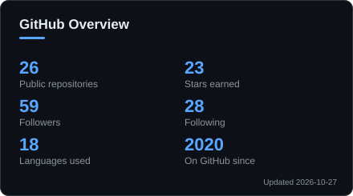
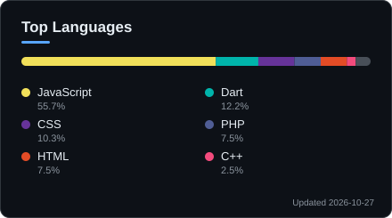
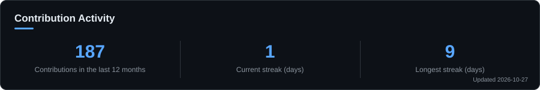

# Hi there, I'm Dev Goyal 

**Computer Engineering undergraduate at [Thapar University](https://www.thapar.edu)**
I build web and mobile products and automation tools.

  

&nbsp;

---

## About 

I am an undergraduate student at [Thapar University](https://www.thapar.edu) pursuing Computer Engineering. I enjoy learning new technology and building products that solve real problems, from web platforms and mobile apps to automation and backend services.

##  Interests

- Web development and full-stack projects
- JavaScript and the Node.js ecosystem
- Mobile development with Flutter and React Native
- Automation and bots
- DIY and hardware projects
- Technical writing: blogs and articles
- Machine learning (currently learning; open to guidance)
- Outside of code: astrophysics, SpaceX launches and sci-fi films

Ask me about web development, app development, or automation. My [resume is on LinkedIn](https://www.linkedin.com/in/dev-goyal-041512203/).

## Languages and Tools

  
  
  
  
  
  
  
  
  
  
  
  
  
  
  
  
  
  
  
  
  
  
  
  
  
  
  
  
  
  
  
  
  
  
  
  
  
  
  
  

## Development Setup

  
  
  
  
  
  
  

## GitHub Statistics

  
  

  

## Connect

  
  
  
  
  

---

<h2><b>"Work like a Samurai. Make no noise; let your work be your voice."</b></h2>

 

<h3 align="center">Thank you for visiting</h3>

  

