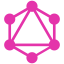
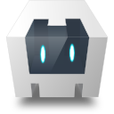
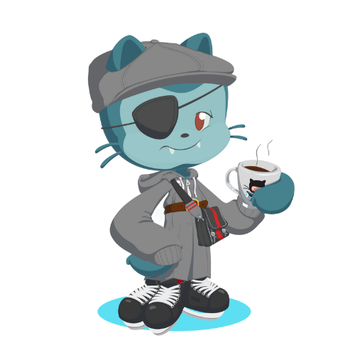

# Hi there, I'm Dev Goyal 

**Undergrad Computer Engineering student @ [Thapar University](https://www.thapar.edu)**
Tech enthusiast who loves building useful products and learning new tech.

  

---

## A little about me 

I'm an **undergrad student 🎓 at [Thapar University](https://www.thapar.edu)** pursuing Computer Engineering. I'm a **tech enthusiast 💻** passionate about learning and working with new tech, and I love building interesting products that serve a real purpose.

##  What I'm into

- 📊 Web development projects
- 🖼 JavaScript
- 🛠 DIY projects
- 🤖 Automation
- 📝 Writing technical blogs and articles
- 🤔 Looking for help with ML
- 💬 Ask me about tricks, web dev, and app dev
- 📙 Check out my [resume](https://www.linkedin.com/in/dev-goyal-041512203/)
- 🎉 Fun fact: I ❤️ astrophysics and SpaceX 🚀 and watch a lot of sci-fi movies 🎬

## 🧰 Languages and tools

  
  
  
  
  
  
  
  
  
  
  
  
  
  
  
  
  
  
  
  
  
  
  
  
  
  
  
  
  
  
  
  
  
  
  
  
  
  
  
  

## 🖥️ My dev setup

  
  
  
  
  
  
  

## 📊 GitHub stats

  
  

  
  

  

  

## 📬 Connect with me

  
  
  
  
  

---

<h2><b>"Work like a Samurai. Make no noise; let your work be your voice."</b></h2>

 

<h3 align="center">Thanks for reading 💖</h3>

  

